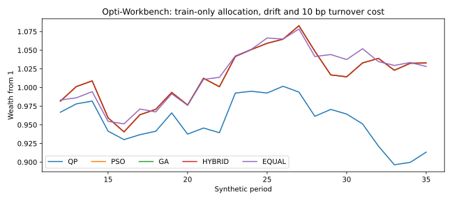

# Opti-Workbench: constrained portfolio optimisation research
Documentation audited on 22 October 2026 against public repository tree/commit `82c9bc7505dc4b01df3c4566b3a6d84589c536ba`.
Source: https://github.com/Anjaney336/opti-workbench/tree/82c9bc7505dc4b01df3c4566b3a6d84589c536ba

## Overview
This repository contains a synthetic-data portfolio-optimisation application and older research modules. The current CLI invokes `optimizer.PortfolioOptimizer`. It compares QP-labelled, particle-swarm (PSO), genetic-algorithm (GA) and hybrid workflows with feasibility, risk and allocation diagnostics.

The implemented engine includes empirical-CVaR convex seeding, subset enumeration, regime-aware inputs, covariance conditioning and heuristic refinement. It is **not a verified FHFA 100-metro exact-MILP benchmark**. No empirical claim of superior returns, runtime or global optimality of the final hybrid is made here.

## Entry points and structure
- `main.py`: `python main.py --demo`; without the flag it prints usage.
- `optimizer/engine.py`: request configuration, method execution and dashboard bundle.
- `optimizer/asset_engine.py`: seeded synthetic asset universes and covariance generation; also accepts supplied assets.
- `optimizer/returns_engine.py`: expected-return machinery.
- `optimizer/solvers.py`: common full objective and QP-labelled/PSO/GA/hybrid workflows.
- `optimizer/advanced.py`: empirical-CVaR convex seed, subset search, rolling and receding-horizon helpers.
- `src/`: legacy mean-variance optimisation, stochastic evaluation and utility modules.
- `backend/api.py`, `frontend/app.py`: API and Streamlit entry points.
- `test_quick.py`: executable smoke/integration checks.
- `paper/real_estate_research_pipeline.py`: separate HouseTS research pipeline; requires an external `HouseTS.csv`. Its dependencies and data provenance are not fully supplied by the main requirements file.
- `results/`: stored outputs. These are not a substitute for a fresh, versioned reproduction.

## Methodology
### Full scoring objective
The engine minimises a weighted combination of covariance risk, negative expected return, cost, negative liquidity, empirical tail risk, diversification-gap penalty, concentration, regime risk, tracking and an entropy bonus. Exact terms are in `optimizer/solvers.py::objective_components`. Preserve those weights when comparing algorithms.

### Convex seed
`optimizer/advanced.py::solve_exact_cvar_seed` introduces a threshold eta and nonnegative auxiliary losses u, with:
`CVaR_alpha = eta + sum(u) / (T * (1 - alpha))`,
`u >= loss - eta`, and `loss = -R @ weights`.

It solves a convex surrogate using CVXPY, attempting OSQP, CLARABEL and SCS. The surrogate contains additional risk and concentration terms. Do not describe it as a pure linear CVaR programme or assume every solver can handle every expression. The implementation accepts both optimal and optimal_inaccurate statuses, which must be logged distinctly.

The surrogate differs from the full heuristic score: in particular the full score includes an entropy term and a different diversification-gap construction. A successful seed solve does not certify a global optimum for the final score.

### Discrete selection and heuristics
`solve_exact_discrete_seed` enumerates fixed-size subsets. When the count exceeds its threshold, it first narrows the candidate universe using a score. This is not a mixed-integer solver. An optimum on a screened shortlist is not a certificate for the full universe; fixed-size enumeration also needs care when interpreting an “at most K” constraint.

PSO and GA search repaired feasible allocations and may warm-start from other methods. Hybrid candidate selection or blending is engineering logic, not proof of universal superiority. Verify feasibility after all projection/repair steps.

## Data and assumptions
| Input | Provenance / URL | Access date / status |
|---|---|---|
| Demo assets and scenarios | Code-generated synthetic inputs: `optimizer/asset_engine.py`, `optimizer/engine.py`; repository URL above | Code inspected 2026-10-22; not observed market data |
| Legacy synthetic dataset | `src/data.py`; `data/metadata.json` records generation settings | Code inspected 2026-10-22; code hash and seed needed for each run |
| HouseTS panel | External `HouseTS.csv` expected by research script | Publisher, URL, licence, access date and hash not yet verified; not supplied or verified |
| FHFA metro data | No corresponding public-code/data pipeline identified in this audited snapshot | Not used in verified demo; do not claim FHFA benchmark results |

All generated returns, costs, liquidity, regimes and model parameters are assumptions. Simulated histories and Monte Carlo paths are not realised property returns. Housing indices, if later added, are not directly investable securities. Never include employer data or publish a dataset without appropriate rights.

## Reproduce the supported demo
From a clean checkout of the audited commit:
```text
python -m venv .venv
# Activate the environment using the command appropriate to your operating system.
python -m pip install -r requirements.txt
python main.py --demo
```
The checked-in demo requests 12 synthetic assets, target 4 active assets, seed 42 and 500 Monte Carlo paths. These are configuration values, not performance results.

Smoke checks:
```text
python -m pip install httpx
python test_quick.py
```
The smoke script imports FastAPI TestClient; its httpx dependency is not declared in the current requirements file. Add it to a development requirements file and lock versions after a clean test. Do not report these commands as freshly passed: this audit inspected code and did not execute the optimiser.

To run the UI:
```text
uvicorn backend.api:app --reload
streamlit run frontend/app.py
```

## Benchmarks to record
Predeclare a common objective, feasible set, asset/scenario seeds, evaluation budget and machine configuration. Report cold and warm starts separately and include seed-generation time. Record each failure, timeout and feasibility residual. Compare convex seed and full objective separately.

| Metric | Result | Computation / evidence |
|---|---|---|
| Feasible-run proportion | Not yet measured in a verified reproduction | valid completed runs / all attempted runs; archive run ledger |
| Median runtime | Not yet measured in a verified reproduction | median wall-clock time including declared stages, on named hardware |
| Full-objective difference | Not yet measured in a verified reproduction | candidate score minus reference score, same objective and constraints |
| Certified optimum gap | Not established for full heuristic objective | Only report where a valid bound/certificate exists for exactly the same problem |
| Empirical loss CVaR | Not yet measured in a verified reproduction | common frozen scenario sample and alpha; compare definitions before aggregation |
| Out-of-sample outcome | Not yet measured in a verified reproduction | time-ordered held-out series with costs; synthetic runs labelled synthetic |
| Seed dispersion | Not yet measured in a verified reproduction | distribution across predeclared independent seeds; no selected best-seed reporting |
| Tests | Not yet measured in a verified reproduction | actual executed checks, command, environment and log |

## Limitations
- No verified MILP implementation or FHFA 100-metro evidence was found in the inspected Python sources.
- Seed and full scoring functions differ. The full score's quantile-tail average can differ from the auxiliary-variable CVaR for finite samples/ties.
- Shortlist subset search does not establish full-universe global optimality.
- Synthetic returns are governed by modelling assumptions; they cannot validate investment alpha.
- HouseTS acquisition/licensing, extra dependencies and reproduction need separate documentation.
- Current requirements use lower bounds, not a tested lockfile; results may vary by environment and solver.
- Stored plots, manuscript prose and successful-looking application outputs are not independent verification.

## Reproducibility checklist
- [ ] Record exact commit and clean working-tree status.
- [ ] Pin Python, dependencies and installed CVXPY solvers; supply tested requirements-lock.txt.
- [ ] Declare all seeds and model weights; save a machine-readable run config.
- [ ] Document every dataset's publisher, URL, observation period, access date, licence and SHA-256.
- [ ] Demonstrate `python main.py --demo` from a clean environment.
- [ ] Run `python test_quick.py`; save output and add focused numerical tests.
- [ ] Test auxiliary-variable CVaR against an independent finite-sample calculation.
- [ ] Test feasibility after projection, zero/degenerate covariance and failed solver statuses.
- [ ] Distinguish enumeration from shortlist search and label surrogate/full objectives.
- [ ] Archive all benchmark attempts and failed runs with fixed budgets.
- [ ] Reconcile resume, README, portfolio and manuscript claims before submission.


## Reproduced train-only evaluation — 24 October 2026

A new standalone `research_harness.py` evaluates QP-labelled, PSO, GA and hybrid methods over four rolling folds (12 training / 6 test periods), with drifted holdings and 10 bp per traded notional. The 10-asset panel is generated from seed 20261024; it is synthetic, not FHFA or live market history.

The harness disables the dashboard's fixed-risk calibration and estimates covariance only on each training window. Exact CVaR seeding and discrete search are disabled for this benchmark; this does not validate every dashboard configuration. Equal-weight uses all ten assets and is not constraint-matched to the optimized three-asset target.

| Method | Net cumulative synthetic return, 24 periods |
|---|---:|
| QP surrogate | −8.661% |
| PSO | 3.288% |
| GA | 3.306% |
| Hybrid | 3.271% |
| Equal weight | 2.822% |

These are one small synthetic experiment, not statistical evidence of superiority. The objectives and search budgets differ. Initial deployment and final liquidation costs are excluded. Four accounting tests verify drift, turnover costs and cost direction.



Reproduce with Python 3.12: `pip install -r requirements-research.txt`, `python test_research_harness.py`, then `python research_harness.py`. Full per-period rows and measured solve times are in `results/audit/`. Named data source: [public generator](https://github.com/Anjaney336/opti-workbench/blob/main/research_harness.py), generated/accessed 24 October 2026. AI-assisted implementation. No raw employer data.


